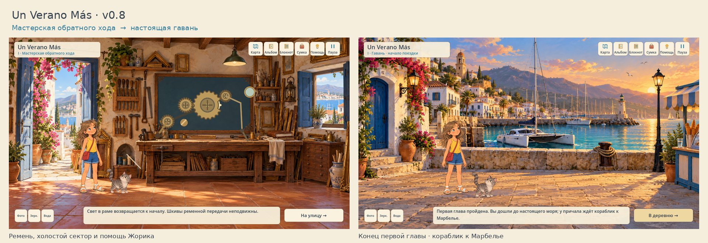

<div align="center">

# Un Verano Más

### A photograph remembers the places. The journey has lost the roads between them.

**A painterly point-and-click adventure through Spain**  
Godot 4.5.1 · GDScript · Playable first chapter · v0.8

[Play the prototype](#play-the-prototype) · [Design case study](docs/CASE_STUDY.md) · [Русский](README_RU.md)



</div>

## One more summer

Lucia finds an old photograph of her grandmother's courtyard. It shows a blue door that is missing from the wall. In the sunlight, the photograph casts the door's shadow — and Zhorik the cat sees it move.

An ordinary Andalusian village opens onto an impossible archive of connected places. To reach the real sea, Lucia must restore the links between light, reflections, echoes and the roads people remember.

The story draws on personal summer memories: a boat to Marbella, ice cream in the old town, turquoise reservoir water, musicians above Ronda and a rooftop evening in Madrid.

## Playable today

| | v0.8 · The Open Road |
|---|---|
| **Places** | Courtyard, kitchen, hidden loggia, reflection street, echo plaza, workshop and harbor |
| **Puzzles** | Five connected puzzles built around light, water, sound, mechanical transmission and spatial deduction |
| **Exploration** | Three-screen courtyard, street and plaza; a following camera and optional observations |
| **Companion** | Zhorik reacts to anomalies, follows into expanded spaces and helps with physical interactions |
| **Continuity** | Inventory, notebook, album, contextual hints, autosaves and migration from earlier versions |

The first chapter ends at the harbor. The boat trip, Marbella and the remaining cities are planned chapters. This repository contains the playable source project; there is no standalone Windows executable in this version.

## Play the prototype

1. Clone the repository, or choose **Code → Download ZIP** and extract it completely.
2. Open **Godot 4.5.1**, select **Import**, and choose the `project.godot` at this repository's root.
3. Wait for the artwork and audio to import, then press **F5**.

```bash
git clone https://github.com/alyalbina/un-verano-mas.git
cd un-verano-mas
godot --editor --path .
```

The prototype was validated on Linux with Godot 4.5.1. Windows has not been tested separately. It runs locally without API keys or paid services. Gameplay text is currently in Russian.

### Controls

| Input | Action |
|---|---|
| Left mouse button | Walk, inspect and interact |
| Inventory item → world object | Use or place an item |
| Drag | Adjust the photograph, board, light spot, mounted mirror or map arrow |
| ← / → or the side arrows | Walk across panoramic locations |
| H / N / T / A / I | Hints / notebook / map / album / inventory |
| M / Esc | Mute / pause |

Hints are optional and unfold in three steps. Experiments are reversible, and solved connections remain anchored when revisited.

## Under the surface

| Module | Responsibility |
|---|---|
| [`reboot_state.gd`](scripts/reboot_state.gd) | Canonical progression, prerequisites, serialization and save validation |
| [`reboot_root.gd`](scripts/reboot_root.gd) | Scene transitions, story beats, inventory actions and persistence |
| [`reboot_world.gd`](scripts/reboot_world.gd) | Navigation, actors, hotspots and world input |
| [`summer_episode.gd`](scripts/summer_episode.gd) | Reflection and musical-fountain interactions |
| [`journey_episode.gd`](scripts/journey_episode.gd) | Workshop mechanism, village map and harbor |
| [`panorama.gd`](scripts/panorama.gd) | Extended locations, camera movement and companion following |
| [`reboot_ui.gd`](scripts/reboot_ui.gd) | Screen-fixed interface, notebook, hints and menus |

Save schema 7 is stored in `user://photograph_v0_8.json`. Existing v0.7, v0.6 and v0.5 saves are migrated without changing the original files.

## Design and validation

- [Design case study](docs/CASE_STUDY.md): the idea, experience goals and key decisions.
- [Current chapter](docs/reboot/V0_8_OPEN_ROAD.md): implemented behavior, puzzle solutions and limitations. **Contains spoilers.**
- [Panoramic exploration](docs/reboot/V0_7_PANORAMAS.md) and [water / echo episode](docs/reboot/V0_6_EPISODE.md): earlier playable milestones.
- [v0.8 validation record](docs/reboot/VALIDATION_V0_8.md): **315 successful checks** documented across rule, startup and live-input suites.
- [Creative vision](docs/reboot/01_creative_vision.md), [GDD](docs/reboot/02_gdd.md), [narrative](docs/reboot/03_narrative.md) and [puzzle bible](docs/reboot/04_puzzle_bible.md): original design history. Later episode documents describe the shipped behavior.
- [Asset provenance](docs/reboot/ASSET_PROVENANCE.md) and [new artwork prompts](docs/reboot/ASSET_PROMPTS_V0_8.md): how the visual resources were made.

A fast rules check can be run with:

```bash
godot --headless --path . --script res://tests/journey_rules.gd
```

See [`tests/`](tests/) for the full suite. Live-input playthroughs require a graphical display and should run individually. Difficulty and play time still need external player testing; prototype animation and synthesized audio are not final production assets.

## Next on the route

**Boat trip → Marbella → reservoir → Ronda → Tarifa → Seville → Madrid**

The next development milestone is the playable catamaran crossing and the old town of Marbella. The broader narrative preserves the reservoir camera rescue, the floating mattress and watermelon, Ronda's music, Tarifa's waves and Madrid's moving clock figures.

---

**Concept and creative direction — [Albina Urubkina](https://github.com/alyalbina).**  
Independent prototype developed with AI-assisted coding and generated illustrations. Source, art, sound and design history are included in this repository.
